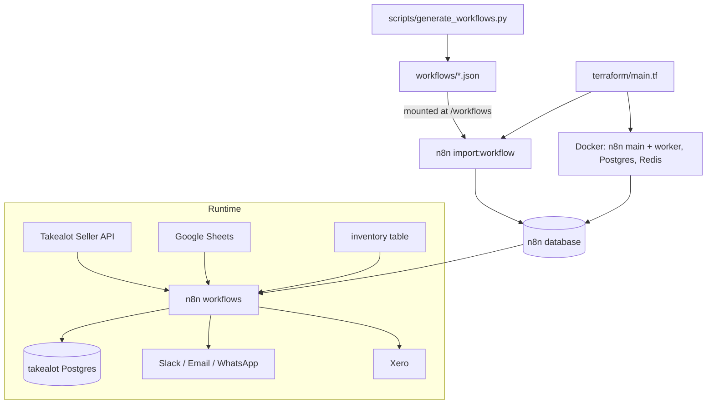
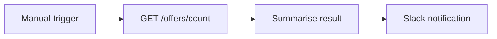
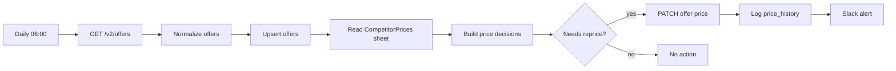
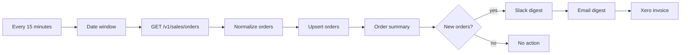
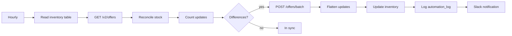
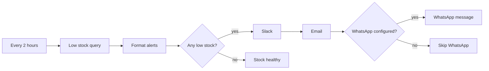
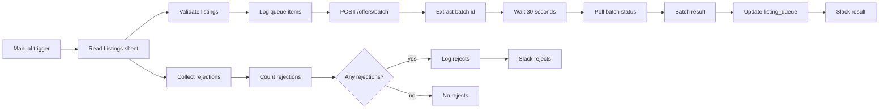
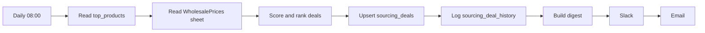

# Takealot reselling automation

Terraform-provisioned, self-hosted n8n stack plus version-controlled workflows for a Takealot reselling business.

## What is included

| Area | Workflow | What it does |
| --- | --- | --- |
| Diagnostics | `00-api-health-check.json` | Verifies the Takealot API key and reports your offer count |
| Pricing | `01-price-monitoring.json` | Pulls your offers, reads competitor prices from Google Sheets, applies an undercut + minimum-margin rule, PATCHes prices, logs history and alerts Slack |
| Orders | `02-order-processing.json` | Imports sales orders every 15 min, upserts to Postgres, sends a Slack + email digest and creates a Xero invoice |
| Inventory | `03-inventory-sync.json` | Compares supplier stock against Takealot stock and submits offer batch updates |
| Alerts | `04-stock-depletion-alerts.json` | Finds offers at/below the reorder threshold and notifies Slack, email and optionally WhatsApp |
| Reporting | `05-sales-profit-reporting.json` | Imports daily sales, joins cost prices, calculates revenue/fees/COGS/profit, writes to Postgres, Sheets, Slack and email |
| Listings | `06-product-listing-automation.json` | Validates a Google Sheets listing queue, submits an offer batch, polls its status and logs rejects |
| Sourcing | `07-top-products-analysis.json` | Ranks the top-selling SKUs by units over the last 30 days and stores current Takealot prices |
| Sourcing | `08-wholesale-deal-finder.json` | Scores wholesalers from a Google Sheet and recommends the best deal per top SKU |

Infrastructure (Terraform): n8n main + optional queue-mode worker, PostgreSQL (n8n metadata + a separate `takealot` business database), Redis, Docker network and volumes. Workflow JSON is imported into n8n with the n8n CLI on `terraform apply` and re-imported whenever a file changes.

## Flow diagrams

### System and code flow



### 00 - API health check



### 01 - Price and competitor monitoring



### 02 - Order processing



### 03 - Inventory sync



### 04 - Stock depletion alerts



### 05 - Sales and profit reporting

```mermaid
flowchart LR
  A["Daily 07:00"] --> B["Yesterday range"]
  B --> C["GET /v2/sales"]
  C --> D["Normalize sales"]
  D --> E["Upsert sales"]
  E --> F["Read Catalogue cost prices"]
  F --> G["Compute daily profit"]
  G --> H["Save profit_daily"]
  H --> I["Append DailyReport row"]
  I --> J["Slack notification"]
  J --> K["Email report"]
```



### 06 - Product listing automation



### 07 - Top products analysis

```mermaid
flowchart LR
  A["Daily 06:30"] --> B["30-day date window"]
  B --> C["GET /v2/sales"]
  C --> D["Aggregate by SKU"]
  D --> E["GET /v2/offers"]
  E --> F["Normalize current prices"]
  F --> G["Join and rank by units"]
  G --> H["Upsert top_products"]
  H --> I["Build digest"]
  I --> J["Slack"]
  J --> K["Email"]
```



### 08 - Wholesale deal finder



## Prerequisites

- Docker Engine / Rancher Desktop running on the host
- Terraform >= 1.3
- Python 3 (only to regenerate workflows)
- A Takealot Seller API key (Seller Portal → API Integration → Seller API)

## Quick start

```bash
cd terraform
cp terraform.tfvars.example terraform.tfvars
# edit terraform.tfvars with your real secrets
terraform init
terraform apply
```

Open `http://localhost:5678`, finish the owner setup, then:

1. Create credentials in n8n (exact names used by the workflows):
   - **Takealot Postgres** — host `takealot-postgres`, port `5432`, database `takealot`, user `n8n`, password = `postgres_password`
   - **Takealot Google Sheets** — OAuth2 account with access to your spreadsheets
   - **Takealot SMTP** — outgoing mail server used by the email nodes
   - **Takealot Xero** — OAuth2 app (optional; only needed for `02-order-processing.json`)
2. Attach each credential to the corresponding nodes in the imported workflows.
3. Run `00-api-health-check.json` manually to confirm API access, then activate the workflows you want.

Imported workflows are **inactive by default** so nothing runs before credentials are set.

## Google Sheets data contracts

| Spreadsheet (variable) | Tab | Columns |
| --- | --- | --- |
| `google_sheets_competitors_id` | `CompetitorPrices` | `sku`, `competitor_price` |
| `google_sheets_catalogue_id` | `Catalogue` | `sku`, `cost_price` |
| `google_sheets_catalogue_id` | `Listings` | `sku`, `barcode`, `selling_price`, `rrp`, `quantity`, `merchant_warehouse_id`, `leadtime_days` |
| `google_sheets_report_id` | `DailyReport` | created by the append node (`report_date`, `revenue`, `fees`, `cogs`, `profit`, `orders`) |
| `google_sheets_wholesale_id` | `WholesalePrices` | `sku`, `wholesaler`, `unit_price`, `shipping`, `stock`, `lead_time_days`, `url` |

## Business database

All files in `sql/` are applied in filename order on apply (`001_schema.sql`, `002_sourcing.sql`). Tables: `offers`, `price_history`, `orders`, `sales`, `inventory`, `profit_daily`, `listing_queue`, `automation_log`, `top_products`, `sourcing_deals`, `sourcing_deal_history`.

The inventory workflow reads `inventory.supplier_stock` and `inventory.reserved_stock`; populate those rows from your supplier/warehouse system (or a separate n8n workflow) for stock sync to have data to push.

### Sourcing workflow details

`07-top-products-analysis.json` aggregates sales from the previous 30 days by SKU, joins the current Takealot selling price, and writes the top `top_products_limit` SKUs to `top_products`.

`08-wholesale-deal-finder.json` reads that ranking and the `WholesalePrices` sheet, then scores each supplier quote per SKU:

- 50% margin score: gross margin percentage divided by `target_margin_percent`
- 20% price score: lowest unit price for the SKU divided by the quote's unit price
- 15% stock score: available stock divided by 30-day units sold
- 15% lead-time score: shorter lead times score higher, zero after 14 days

Landed cost is `unit_price + shipping`; gross margin is `takealot_price - landed_cost`. The highest-scoring quote wins per SKU and is saved to `sourcing_deals`, with each run recorded in `sourcing_deal_history`. Results are sent as a Slack and email digest.

## Configuration

All settings live in `terraform/variables.tf`. Secrets should be supplied via `terraform.tfvars` (gitignored) or `TF_VAR_*` environment variables, e.g.:

```bash
export TF_VAR_takealot_api_key="..."
export TF_VAR_postgres_password="..."
```

Values are injected into the n8n containers and read in workflows with `{{ $env.NAME }}`. Sourcing-specific settings: `google_sheets_wholesale_id`, `top_products_limit` (default 25) and `target_margin_percent` (default 25).

## Takealot API notes

The workflows use the Seller API style endpoints (`/v2/offers`, `/v1/sales/orders`, `/v2/sales`, `/v2/offers/batch`) with an `X-API-Key` header. Takealot exposes both a Seller API (`seller-api.takealot.com`) and a newer Marketplace API (`marketplace-api.takealot.com`) with different paths/pagination. If your account uses the other API, change `takealot_api_base_url`/`takealot_api_version` and adjust the URLs in `scripts/generate_workflows.py`, then regenerate.

## Regenerating workflows

```bash
python3 scripts/generate_workflows.py
terraform -chdir=terraform apply
```

The generator contains reusable node builders; edit it rather than the generated JSON files.

## Known limitations

- Offer/sales reads handle the first page (up to 100 offers). Add pagination around the HTTP Request nodes for larger catalogues.
- Price decisions are simple undercut + floor rules; extend `Build Price Decisions` for complex repricing strategies.
- Xero AccountCode and warehouse ID are placeholders; align them with your chart of accounts and warehouse setup.
- Email/Slack/WhatsApp nodes fail silently in the UI if their credentials/webhooks are left blank — configure them or remove those nodes.
- Wholesale quotes come from the `WholesalePrices` sheet only; to track live supplier sites you need to add scraping/API nodes per supplier. Shipping, currency conversion and tax are not modelled beyond the `shipping` column.
